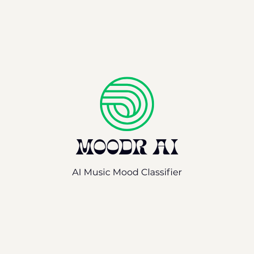

# *Moodr AI: an AI Music Mood Classifier*

## Product Logo


## Description / Motivation

Moodr AI predicts the emotional mood of a song from its audio signal and turns a folder of music into a **mood-sorted catalogue**: a browsable page, plus one Spotify playlist per mood.

It extracts features such as MFCCs, chroma, tempo, spectral properties, major/minor mode and loudness, then predicts the two dimensions of emotion psychologists call *valence* (negative to positive) and *arousal* (calm to energetic). The two scores place each song on a 3×3 mood map.

The project is:

- **Fun**: lets you explore music by *emotion*, not genre.
- **Practical**: sorts a large library into playlists without listening to every track.
- **Technically rich**: audio signal processing, classical ML, a CNN, evaluation against human ratings, and a third-party API.

---

## How it works

```
audio files ──> features (MFCC, chroma, tempo, mode, loudness)
            ──> models ──> valence + arousal ──> one of nine moods
            ──> Spotify search (matches file to track) ──> SQLite catalogue
            ──> catalogue page (data/catalogue.html) + Spotify playlists "Moodr: <mood>"
```

Spotify no longer provides audio analysis to new apps, so Moodr classifies **audio files on your own machine** and uses Spotify only to identify each track, link to it, and hold the playlists.

### The mood map

Each score is cut into low / mid / high bands, giving nine moods:

| | Low valence (darker) | Mid valence | High valence (brighter) |
|---|---|---|---|
| **High arousal** | intense | energetic | euphoric |
| **Mid arousal** | brooding | neutral | cheerful |
| **Low arousal** | melancholy | mellow | serene |

### Models

| Name | What it is |
|---|---|
| `logreg`, `svm`, `rf` | scikit-learn classifiers (high vs low), trained on DEAM |
| `cnn` | CNN on Mel spectrograms plus global audio statistics |
| `reg` | **default.** Random forest regression on the 1–9 DEAM scores using 50 features, converted to percentiles among DEAM songs |
| `ensemble` | average of the four classifiers |

You can pin any song to a mood you choose. Pinned moods always win over the model's, and are marked "corrected" in the catalogue.

---

## Quick start

Requires **Python 3.14**: the pinned versions in `requirements.txt` don't install on older Pythons (we hit this on 3.9). Developed on macOS. The GUI needs Tk (`brew install python-tk@3.14` with Homebrew Python). The trained models are included, so there is **nothing to train and no dataset to download**.

```bash
git clone --depth 1 https://github.com/masone3/MoodrAI.git moodrai && cd moodrai
python3.14 -m venv .venv && source .venv/bin/activate
python -m pip install -r requirements.txt
python -m pytest tests -q
```

`--depth 1` skips the project history, which keeps the download small.

### Classify a folder (no Spotify needed)

```bash
python3 -W ignore build_catalogue.py ~/path/to/mp3s --no-spotify
python3 -W ignore export_catalogue.py --open
```

Name files `Artist - Title.mp3`; Spotify matching works best with that pattern. Songs already in the catalogue are skipped, so you can rerun it as the folder grows.

### Add Spotify matching and playlists

1. Create an app at developer.spotify.com/dashboard (choose **Web API**) with the redirect URI `http://127.0.0.1:8888/callback`. Your own account must be on the app's user list.
2. Copy `.env.example` to `.env` and paste in your Client ID. Never commit `.env`.
3. Check that everything works: `python3 spotify_smoke_test.py`
4. Build and sync:

```bash
python3 -W ignore build_catalogue.py ~/path/to/mp3s
python3 -W ignore sync_playlists.py --dry-run   # preview
python3 -W ignore sync_playlists.py             # create/update the playlists
```

Spotify's Development Mode requires the app owner to have Premium, allows five authorised users, and gives each developer one Client ID, so anyone else running this needs their own Spotify app. Playlists are created private.

### Correct a mood

```bash
python3 -c "from codebase.catalogue import open_db, set_override; set_override(open_db(), 'Artist - Title.mp3', 'serene')"
python3 -W ignore sync_playlists.py   # moves the song to the right playlist
```

### Desktop GUI

`python3 gui.py` classifies a single file with any model and plots it on the nine-mood map.


### Training from scratch (optional)

Not needed to use Moodr: the trained models are in `models/`. To retrain, download the DEAM dataset from its official page and place it under `data/DEAM/` (this repo does not include it), then run:

```bash
python3 -W ignore main.py --model_type all    # classifiers and CNN (the CNN is slow)
python3 -W ignore build_harmony_features.py
python3 -W ignore train_regression.py
```

---

## How well does it work?

| Evidence | Result |
|---|---|
| Cross-validated on DEAM (1,802 songs), `reg` model | R² 0.47 for valence, 0.49 for arousal |
| Against my own mood ratings of 26 songs, rank correlation | arousal 0.57–0.67 (CNN 0.36); valence 0.06–0.34 for every model |

**Energy is predicted reasonably well; positivity is not.** On my test songs, every model's valence score tracked its arousal score almost one-for-one (correlation 0.84–0.97, against 0.58 in DEAM's own labels), so loud songs were called "happy." Heavy rock, a genre DEAM covers thinly, is the clearest failure. The sample is small and has a single rater, so treat these as indicative, not conclusive. That is why corrected moods are first-class: where the model is wrong, your ears win.

Processing speed: 0.2 s per song

---

## Project structure

```
codebase/       features, models, mood map, prediction, matching, catalogue, Spotify client
tests/          pytest suite (features, models, moods, matching, catalogue, sync, page)
data/DEAM/      DEAM annotations and cached features
models/         trained model files
main.py         trains the classifiers and the CNN
train_regression.py, build_harmony_features.py   train the default `reg` model
build_catalogue.py, sync_playlists.py, export_catalogue.py   the catalogue pipeline
score_testsongs.py, compare_models.py            check models against your own ratings
```

---

## Scope

**In scope**
- Audio loading and preprocessing (30-second analysis windows)
- Feature extraction using Librosa plus custom global statistics and harmony features
- Classifiers (LogReg, SVM, Random Forest), a regression model, and a CNN
- A nine-mood map with confidence and manual correction
- Spotify track matching and one playlist per mood
- A browsable catalogue page and a desktop GUI
- Validation against personal ratings, and a unit test suite

**Out of scope**
- Real-time mood detection
- Multimodal (lyrics + audio) mood detection
- Multi-label emotion prediction
- Classifying songs without an audio file on disk

---

## Vision

Moodr AI aims to provide an accessible bridge between music and emotion. The MVP enables emotional classification for individual tracks, but the design supports long-term expansion into personalized recommendation systems, playlist generation, therapy tools, or research platforms.

---

## Prerequisites

- **Python 3.14**
- An IDE such as VS Code or PyCharm (optional)
- Python libraries, all pinned in `requirements.txt`:
  - `librosa`, `soundfile` – audio loading and feature extraction
  - `numpy`, `pandas` – feature processing
  - `scikit-learn` – classifiers and the regression model
  - `torch` – the CNN
  - `matplotlib`, `tkinter` – visualization and the desktop GUI
  - `spotipy`, `python-dotenv`, `requests` – Spotify login and API calls
  - `tqdm`, `pytest` – progress bars and the test suite
- A Spotify Premium account and your own Spotify developer app, only if you want playlists

---

## Requirements

Moodr AI analyzes a 30-second slice of audio and predicts valence and arousal scores. These values are mapped to one of nine moods.

More details: [requirements link](requirements.md)

---

## Design

The architecture is split into modular components:

- `features.py` – classical feature extraction (MFCCs, chroma, tempo, etc.)
- `features_extra.py` – global audio stats (RMS, tempo, onset flux, dynamic range)
- `cnn_model.py` – spectrogram extraction, dataset, and CNN architecture
- `baseline_classifier.py` – scikit-learn models and training
- `data_loader.py` – DEAM dataset parsing and labeling
- `gui.py` – the Tkinter user interface
- `main.py` – unified training entry point supporting multiple model types
- `predict.py` – one entry point that turns an audio file into valence, arousal and a mood
- `moods.py` – the nine-mood map and its boundaries
- `catalogue.py`, `catalogue_page.py` – the SQLite catalogue and the browsable page
- `matching.py`, `spotify_client.py`, `sync.py` – Spotify matching and playlists

More information: [design link](design.md)

---

## Test Plan

Moodr AI includes a full `pytest` suite covering:

- Feature extraction and numerical correctness
- Global audio statistics robustness
- Spectrogram dataset construction and normalization
- GUI behavior (model selection, missing file handling)
- Edge-case handling such as empty audio and invalid paths
- The mood map, catalogue, Spotify matching and sync logic (the Spotify calls are replaced by test doubles, so no login is needed)

Updated test plan: [test plan link](test.plan.md)

---

## Built With

- **Spotify Web API (spotipy)** – track matching and playlists
- **SQLite** – the song catalogue
- **Librosa** – Music/audio analysis  
- **Scikit-learn** – Baseline models (LogReg, SVM, Random Forest)  
- **PyTorch** – CNN classifier on spectrograms  
- **Tkinter** – User interface  
- **Pandas** – Annotation data handling  
- **NumPy** – Feature computation  
- **Matplotlib** – Visualization (nine-mood map + training graphs)
- **tqdm** – Progress bars for CNN training  
- **WeightedRandomSampler (PyTorch)** – Balanced batch training for imbalanced DEAM labels  
- **pytest** – Comprehensive unit test suite  
- **pickle** – Saving/loading models  
- **VS Code** – Primary development IDE  

---

## Author

**Easton Mason** — Lead Developer  
LinkedIn: https://www.linkedin.com/in/easton-mason/

Easton designed, implemented, tested, and documented all components of Moodr AI. His passion for both music and machine learning inspired a system that blends signal processing with emotional understanding.

---

## Acknowledgments

- **DEAM Dataset** (Aljanaki, Yang & Soleymani, 2017, *Developing a benchmark for emotional analysis of music*, PLOS ONE) – source of the labeled valence–arousal data used to train the models 
- Community documentation from Librosa, Scikit-learn, and PyTorch  
- Professor Wilborne and peers at Berea College  
- Berea College for supporting this capstone project  

---

## License

This project is released under the MIT License.  
See: https://en.wikipedia.org/wiki/MIT_License
